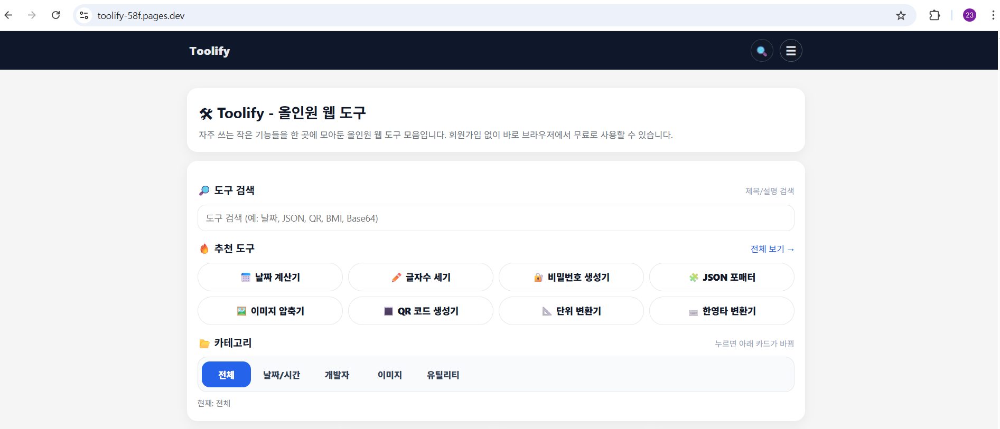

## 들어가며

Toolify는 정적 사이트로 운영 중이며, 정책과 운영 편의성의 이유로 Vercel에서 Cloudflare Pages로 이전했습니다.
이 글은 **이전 과정에서 실제로 막혔던 포인트를 재현 가능한 체크리스트로 정리**하는 것이 목적입니다.

---

## 0) 기존 구성 (이전 전)

- Repo: `github.com/jsc5023/toolify`
- Hosting: Vercel
- Domain: `https://toolify.kr/`

---

## 1) Cloudflare Pages를 선택한 이유

- 정적 배포가 목표였고, GitHub 연동이 쉬움
- Vercel 무료 플랜에서 느낀 제약/불안 요소가 있었다
- 추가로 Workers로 API 프록시 확장 가능성을 생각했음

---

## 2) 사전 준비

### 변수 하나만 정해두기
Cloudflare Pages 프로젝트가 만들어지면 기본 도메인이 생깁니다.

- `PAGES_DOMAIN = toolify-58f.pages.dev`  ← **내 Pages 기본 도메인**
  - ⚠️ 본인 프로젝트의 `*.pages.dev`로 바꿔서 사용하세요.

---

## 3) 이전 절차 (Step-by-step)

### Step 1) Cloudflare Pages에서 프로젝트 생성

1) `https://pages.cloudflare.com/` 접속
2) Pages → **Create project** → **Connect to Git**
3) Repo 선택: `https://github.com/jsc5023/toolify`

#### ✅ Build 설정 (정적 사이트 / 빌드 없는 HTML 구조 기준)
Toolify가 “그냥 HTML/CSS/JS”로 돌아가는 정적 사이트라면 아래처럼 설정하면 됩니다.

- Framework preset: `None` (또는 `Static HTML`)
- Build command: **비움** (empty)
- Output directory: `/` (루트)

> 이 설정은 “레포 루트에 `index.html`이 있는 구조”에 해당합니다.  
> (대부분의 간단한 정적 사이트는 여기로 끝)

#### ⚠️ 만약 빌드 도구를 쓴다면(React/Vite/Next 등)
빌드 산출물이 `dist/` 또는 `build/`에 생기는 구조면 위 설정이 아니라 아래 중 하나로 맞춰야 합니다.

- Vite: Build command `npm run build`, Output `dist`
- CRA: Build command `npm run build`, Output `build`
- Next.js: (Pages가 아니라 Workers/Pages 설정이 다를 수 있음. 이 글은 “정적 사이트” 기준)

#### ✅ 1차 검증(가장 중요)
배포가 끝나면 `https://{project}.pages.dev` 가 생깁니다.  
**커스텀 도메인을 붙이기 전에**, 아래를 먼저 확인합니다.

- `https://PAGES_DOMAIN` 접속 → **메인 페이지가 정상 렌더링되는지**

> 여기서 실패하면 DNS 만지기 전에 “빌드/출력 디렉토리”부터 다시 봐야 합니다.  
> (DNS는 정상인데 화면이 404인 경우 대부분 Output directory가 틀린 케이스)

---

### Step 2) Cloudflare Pages에 커스텀 도메인 추가 (toolify.kr / www)

Cloudflare → Workers & Pages → Pages → **(Toolify 프로젝트)** → **Custom domains**

1) `toolify.kr` 추가 (자기 페이지 도메인입니다.)
2) `www.toolify.kr` 추가 (www 붙인 도메인 페이지 입니다.)

✅ **체크 포인트**
- Cloudflare가 “DNS 레코드 자동 생성” 또는 “어떤 레코드를 넣으라”는 안내를 줍니다.
- 안내가 뜨면 **그대로 따라야 합니다.**  
  (여기서 Vercel 값이 남아있으면 100% 꼬입니다)

---

### Step 3) (중요) 가비아에서 네임서버를 Cloudflare로 변경

Cloudflare에서 도메인이 **Active**가 되려면, 등록기관(가비아)에서 네임서버를 Cloudflare로 바꿔야 합니다.

Cloudflare가 준 네임서버(예시):
- `margot.ns.cloudflare.com`
- `merlin.ns.cloudflare.com`

가비아 → **네임서버 설정**에서
- 기존 `ns.gabia...` 제거
- Cloudflare 네임서버 2개 입력 후 저장

✅ 검증 방법
- Cloudflare **Domain Management**에서 상태가 `Invalid nameservers` → `Active`로 변경됨

---

### Step 4) (핵심) DNS 레코드 “Vercel → Pages”로 정리

여기서 가장 많이 막힙니다.  
**Vercel 흔적(A 레코드 / www CNAME)** 이 남아 있으면 도메인이 Pages로 가지 않습니다.

Cloudflare → DNS → Records에서 다음을 확인/정리합니다.

#### ❌ 삭제 대상(예시)
- `A  @  216.198.79.1`  ← Vercel/기존 호스팅으로 향하는 값일 가능성 큼
- `CNAME  www  0f045a...vercel-dns.com` ← Vercel

#### ✅ Pages로 교체(권장 형태)
정적 Pages로 붙일 때 가장 쉬운 형태는 아래입니다.

- `CNAME  @    PAGES_DOMAIN`
- `CNAME  www  PAGES_DOMAIN`
- Proxy status: **Proxied(주황 구름)** 권장

> 주의: DNS UI에서 `@` 대신 루트 도메인을 직접 `toolify.kr`로 보일 수도 있습니다.  
> 의미는 같습니다(루트 도메인).

✅ 검증
- `https://toolify.kr` / `https://www.toolify.kr` 둘 다 **Pages와 동일한 화면**이 나오는지 확인

---

### Step 5) Cloudflare 적용 여부 확인(cdn-cgi/trace)

Cloudflare 적용 확인용으로 아래 URL이 자주 쓰입니다.

- `https://toolify.kr/cdn-cgi/trace` (자기도메인/cdn-cqi/trace)

✅ 정상이라면 흰 화면에 텍스트가 나오며, 대략 이런 항목들이 보입니다:
- `colo=...`
- `tls=TLSv1.3`
- `http=http/3`
- `loc=KR` 등

> 예전에 `404 NOT_FOUND`가 나왔다면, 그건 “아직 Cloudflare로 Active가 아니었거나 / 프록시가 아니었거나 / 도메인이 아직 Vercel을 바라보던 상태”였을 확률이 큽니다.

---

## 4) 자주 겪는 문제 & 해결

### (1) Cloudflare에 `Invalid nameservers`가 계속 뜬다
- 가비아에서 Cloudflare 네임서버 2개가 정확히 들어갔는지 확인
- 기존 가비아 네임서버가 하나라도 남아 있으면 안 됨
- 저장 후 전파(Propagation) 시간 때문에 잠시 지연될 수 있음

### (2) `cdn-cgi/trace`가 404 또는 사이트가 엉뚱한 곳으로 간다
- DNS에 **Vercel A 레코드**가 남아있지 않은지 확인
- `www` CNAME이 Vercel 값인지 Pages 값인지 확인
- 루트(@)도 Pages로 연결되어 있는지 확인

### (3) “This hostname is not covered by a certificate” 경고가 뜬다
DNS 변경 직후에는 인증서가 아직 발급 전이라 뜰 수 있습니다.  
대부분 시간이 지나면 자동 해결됩니다.

추가로 확인할 것:
- Cloudflare → SSL/TLS → 모드가 일반적으로 `Full`이면 충분

---

## 5) 최종 체크리스트 (이 글의 핵심)

- [ ] `https://PAGES_DOMAIN` 먼저 정상 접속(커스텀 도메인 전 1차 성공)
- [ ] Pages → Custom domains에 `toolify.kr`, `www.toolify.kr` 추가
- [ ] 가비아 네임서버를 Cloudflare 2개로 변경
- [ ] DNS에서 Vercel A/CNAME 제거
- [ ] `@`/`www`를 `PAGES_DOMAIN`으로 CNAME 연결
- [ ] `https://toolify.kr/cdn-cgi/trace`로 Cloudflare 경유 확인

---

## 6) 메모 (나중에 또 이전할 때를 위해)

- “Pages 기본 도메인 정상” → “네임서버 Active” → “DNS 레코드 정리” 순서가 가장 안전하다.
- DNS는 한 번 꼬이면 원인 추적이 어려우니,
  - **Vercel 흔적(A / www CNAME) 제거**
  - **루트와 www를 동일한 목표(PAGES_DOMAIN)로 통일**
    이 두 가지가 핵심.

