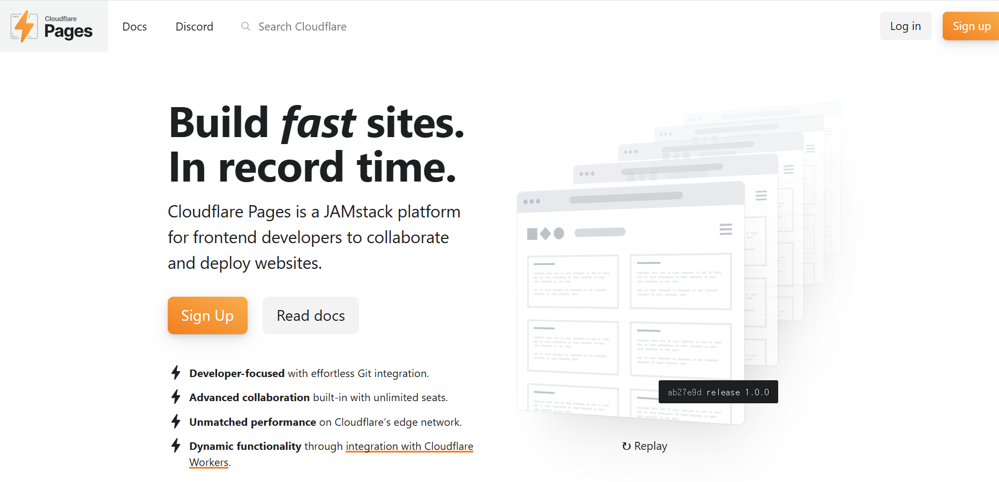

## 들어가며

Toolify는 정적 사이트로 운영 중이며, (광고/정책/비용/성능/운영 편의성) 이유로 Vercel에서 Cloudflare Pages로 이전했습니다.
이 글은 **이전 과정에서 실제로 막혔던 포인트를 재현 가능한 체크리스트로 정리**하는 것이 목적입니다.

## 1. 기존 구성 (이전 전)

- Repo: github.com/jsc5023/toolify
- Hosting: Vercel
- 도메인: https://toolify.kr/

## 2. Cloudflare Pages를 선택한 이유

- 정적 배포가 목표였고, GitHub 연동이 쉬움
- (Vercel 무료 플랜에서 느낀 제약/불안 요소가 있었다)
- (추가로 Workers로 API 프록시 확장 가능성)

## 3. 이전 절차 (Step-by-step)

### Step 1) Cloudflare Pages에서 프로젝트 생성
- https://pages.cloudflare.com/ 접속
 
- Pages → Create project → Connect to Git
- Repo 선택: https://github.com/jsc5023/toolify
